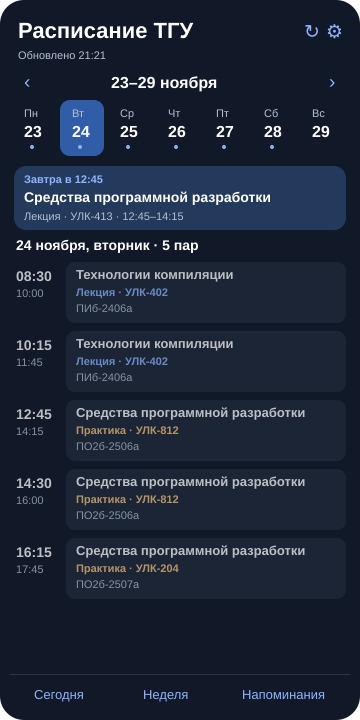
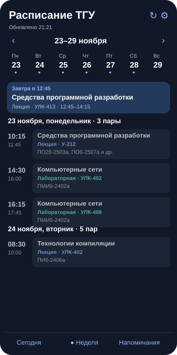

# Расписание ТГУ

  

Неофициальное нативное Android-приложение для преподавателей Тольяттинского государственного университета. Расписание загружается напрямую из API ТГУ — без WebView, рекламы и Google Play Services.

## Демонстрация интерфейса

<p align="center">
  
  &nbsp;&nbsp;
  
</p>

<p align="center"><b>Режим дня</b> &nbsp; • &nbsp; <b>Режим недели</b></p>

Иллюстрации интерфейса по результатам тестирования на HONOR Magic 9, с примерами расписания. Это SVG-реконструкции экранов, а не оригинальные скриншоты APK.

В режиме дня можно выбрать дату или перелистнуть день свайпом. В режиме недели отображаются занятия всех семи дней без выделения отдельной даты. Карточка ближайшей пары содержит время, дисциплину и аудиторию.

## Возможности

- Расписание на день и неделю, свайпы между днями.
- Дисциплины, группы, аудитории, типы занятий.
- Текущая и ближайшая пара, обратный отсчёт.
- Выбор преподавателя по ID или ссылке на его расписание.
- Локальный кеш для каждого преподавателя.
- Напоминания за 5, 10, 15, 20 или 30 минут.
- Фоновое обновление примерно раз в час.
- Тестовое уведомление и проверка будильника через 30 секунд.
- Тёмный компактный интерфейс.

## Установка

1. Откройте [последний релиз](https://github.com/gerasimovtltsu/tlt-su-schedule/releases/latest).
2. В разделе **Assets** скачайте `ScheduleTGU.apk`.
3. Откройте файл на Android и установите приложение.

APK автоматически публикуется в [Releases](https://github.com/gerasimovtltsu/tlt-su-schedule/releases) после успешной сборки основной ветки. Изменения документации не запускают сборку. ZIP-артефакт также доступен в [GitHub Actions](https://github.com/gerasimovtltsu/tlt-su-schedule/actions).

Репозиторий публичный: APK доступен без авторизации в GitHub. APK имеет отладочную подпись; обновление поверх старой версии возможно только при совпадении подписи.

## Обновления приложения

Приложение проверяет публичный GitHub Releases API при запуске и примерно раз в сутки через фоновую задачу. Ручная проверка: «Настройки → Проверить обновления». При новой версии отображается описание изменений или системное уведомление со ссылкой на APK. Скачивание выполняется браузером, установка подтверждается пользователем. Сравнивается versionName, поэтому для каждого нового обновления необходимо повышать версию приложения. Сборки с той же версией не считаются обновлениями. Для установки поверх старой версии нужна одинаковая подпись APK.

## Выбор преподавателя

Откройте расписание преподавателя на [rasp.tltsu.ru](https://rasp.tltsu.ru/), скопируйте ссылку вида `https://rasp.tltsu.ru/teacher/15943?isWeek=true` и вставьте её в настройках приложения, в пункте «Преподаватель». Можно ввести только числовой ID. Имя загружается из ответа API при наличии занятий.

## Настройка уведомлений

Разрешите уведомления и точные будильники. На HONOR / MagicOS также проверьте разрешение фонового запуска и ограничения батареи. В меню напоминаний запустите тест будильника через 30 секунд и заблокируйте экран. Фоновая синхронизация зависит от системных ограничений Android.

## Сборка из исходников

Требуются JDK 17, Android SDK 35 и Gradle 8.9.

```sh
gradle assembleDebug
```

Результат: `app/build/outputs/apk/debug/app-debug.apk`.

## Архитектура

MVVM на AndroidX Lifecycle (ViewModel + LiveData), нативные Android Views, Repository, HttpURLConnection, JSON, SharedPreferences, AlarmManager, JobScheduler. Сетевой слой, кеш, модели, интерфейс, фоновые задачи и уведомления разделены. Границы недели рассчитываются в Europe/Samara и передаются API в UTC; часы занятий интерпретируются как местное время ТГУ.

[Подробная структура проекта](docs/architecture.md). Модульные тесты: `gradle testDebugUnitTest`. CI запускает тесты перед сборкой и публикацией APK.

Проект не является официальным приложением университета. Работоспособность зависит от доступности API ТГУ.
