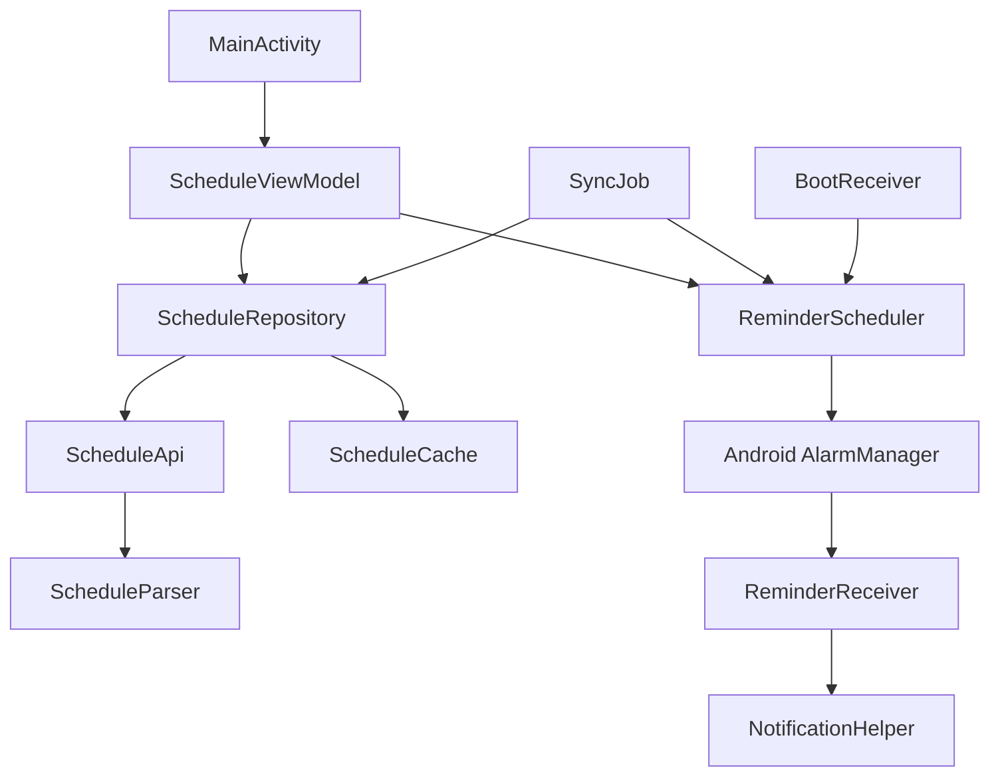

# Архитектура приложения

Версия 0.5.0. MVVM + Repository. Один Gradle-модуль, разделение по слоям и обязанностям.

| Слой | Назначение |
|---|---|
| domain/model | Модель занятия, расчёт времени начала и конца |
| data/remote | HTTP-запросы и разбор ответа API |
| data/local | Кеш недель и настройки преподавателя |
| data/repository | Единая точка получения расписания |
| ui/schedule | ViewModel, состояние экрана и построение нативного интерфейса |
| ui/settings | Диалоги настроек, выбор преподавателя, диагностика |
| notification | Регистрация будильников, канал уведомлений, обработчик срабатывания |
| worker | Периодическое обновление и обработка системных событий |
| util | Часовой пояс, границы недели, расчёт напоминаний |

MainActivity связывает ViewModel и экран, обрабатывает жизненный цикл и жесты. ViewModel не содержит View/Activity; состояние передаётся через LiveData. Сетевые запросы выполняются на одном рабочем потоке.

Компоненты MainActivity, BootReceiver, SyncJob и ReminderReceiver сохранили исходные полные имена для совместимости с манифестом и ранее запланированными будильниками. Сохранены applicationId, имя файла SharedPreferences, ключи кеша и ID канала уведомлений. Для существующих установок миграция хранилища не требуется.

Сетевой транспорт и SharedPreferences намеренно сохранены при первом рефакторинге: переход на Retrofit, Room и DataStore следует выполнять с отдельной проверкой миграции данных. Динамические карточки используют Android Views; корневой контейнер вынесен в XML.

## Тестирование

`gradle testDebugUnitTest` — тесты UTC-границ недели, локального времени пары и вычисления времени напоминаний. GitHub Actions выполняет их до сборки APK. Проверка фоновых уведомлений на реальном устройстве остаётся отдельной задачей.
